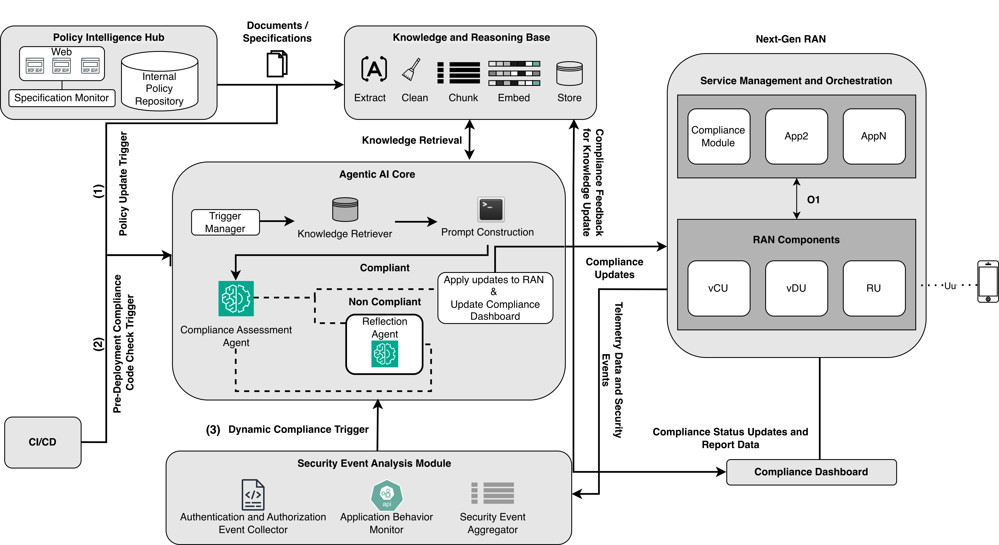
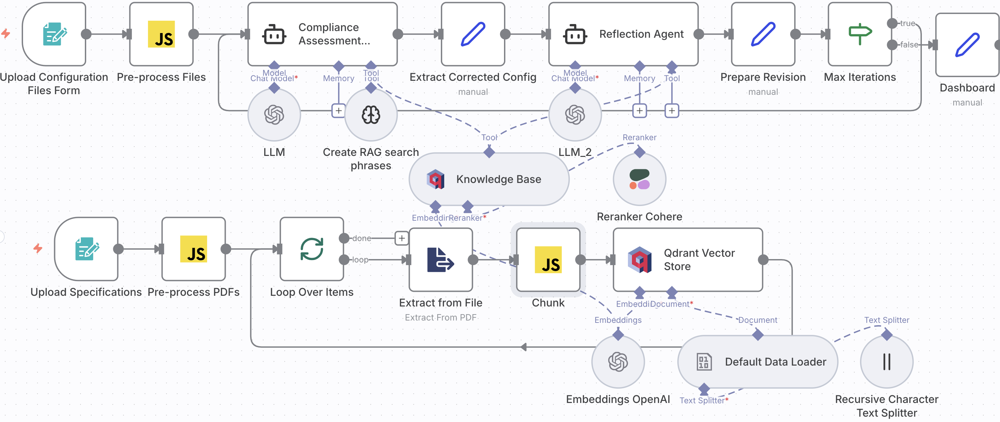

# Agentic AI for 6G: Autonomous RAN Security Compliance

Companion repository for the paper:

> S. Chatzimiltis, M. Boloursaz Mashhadi, M. Shojafar, M. Debbah, and R. Tafazolli,
> **"Agentic AI for 6G: A New Paradigm for Autonomous RAN Security Compliance,"**
> *IEEE Communications Magazine* (under review).

The repository contains the n8n prototype, the RAN configuration files and operator policy used as test inputs, the raw outputs from every evaluation run, and the notebooks that produce the paper's metrics and figures.



## Overview

A **Compliance Assessment Agent** checks a RAN network-function configuration (OAI / srsRAN CU, CU-CP, CU-UP) against 3GPP / O-RAN security specifications and an internal operator policy. It uses retrieval-augmented generation (RAG) over a knowledge base of those specifications. When the configuration is non-compliant, the agent also proposes a corrected version. A **Reflection Agent** critiques each answer and sends it back for revision until the answer is accepted or a maximum number of iterations is reached.

Three retrieval settings are compared: **No-RAG**, **RAG**, and **Agentic RAG** (which adds a dedicated RAG Query Generator Agent). Each setting is evaluated with GPT-4.1, Gemini 2.5 Flash, and Mistral Large.



## Repository structure

```
workflows/        n8n workflow exports (import into n8n)
web/              HTML front-end that submits configs to the n8n webhook
data/
  configs/        RAN configuration files evaluated (compliant and non-compliant variants)
  policies/       Internal operator security policy (OP-SEC-001..003)
evaluations/
  UpdatedVersionEvals/   Results reported in the paper
    NoRAG/ RAG/ AgenticRAG/ AgenticRAG_new/   per-model HTML outputs, <config>_R<run>.html
    Evaluations.xlsx     scored results (accuracy, code correctness, clause correctness, time)
  Experiment1-3/         Earlier exploratory runs
analysis/         Jupyter notebooks for BERTScore and the result plots
figures/          Paper figures (PNG/PDF) and draw.io sources
knowledge_base/   List of the specifications used for RAG (not redistributed; see below)
```

## Workflows

| File | Description |
|---|---|
| `workflows/compliance_assessment_agentic_rag.json` | **Main workflow used for the paper's results.** Compliance Assessment Agent with a RAG Query Generator tool, Reflection Agent with structured outputs and an iteration limit, three Qdrant knowledge bases (3GPP, O-RAN, operator policies), Cohere reranking, and an HTML dashboard response. GPT-4.1, Gemini 2.5 Flash and Mistral Large chat-model nodes are included; connect the one you want to evaluate. |
| `workflows/compliance_assessment_openai_rag.json` | Earlier, simpler prototype: OpenAI only, with an in-memory vector store. |

## Running the prototype

1. Install [n8n](https://docs.n8n.io/hosting/) (e.g. `npx n8n` or Docker) and open it at `http://localhost:5678`.
2. Start a local [Qdrant](https://qdrant.tech/documentation/quickstart/) instance (`docker run -p 6333:6333 qdrant/qdrant`).
3. Import `workflows/compliance_assessment_agentic_rag.json` via **Workflows → Import from File**.
4. Create the n8n credentials and assign them to the nodes marked `YOUR_..._CREDENTIAL`:
   - Qdrant (local)
   - OpenAI (embeddings and GPT-4.1)
   - Cohere (reranker)
   - Google Gemini and/or Mistral Cloud, for the model you are testing
5. Download the specifications listed in [`knowledge_base/SOURCES.md`](knowledge_base/SOURCES.md). Load them through the form triggers, which fill these Qdrant collections:
   - **Upload Specifications** → `rag_compliance_33501` (3GPP)
   - **Upload O-RAN Specifications** → `oran_specs`
   - **Upload Internal Policies** → `operator_policies` (use `data/policies/`)
6. Submit a configuration from `data/configs/` through the **Upload Configuration Files Form**, or open `web/submit_form.html` in a browser. It posts to the `/openran/compliance` webhook.

The No-RAG and RAG baselines were obtained from the same workflow by disconnecting the RAG Query Generator tool, or by giving the knowledge-base tools directly to the Compliance Assessment Agent.

## Reproducing the analysis

```bash
pip install -r requirements.txt
jupyter notebook analysis/
```

- `analysis/plot_results.ipynb`: response-time and accuracy plots (`figures/results_plot.*`, `figures/accuracy_plot.*`)
- `analysis/bert_score.ipynb`: BERTScore consistency between repeated explanations of the same input

## Knowledge base

The RAG knowledge base was built from 3GPP and O-RAN Alliance specifications and from security-relevant source files of OpenAirInterface and srsRAN. These documents are copyrighted by their publishers, or covered by their own licenses, so they are **not included** here. [`knowledge_base/SOURCES.md`](knowledge_base/SOURCES.md) lists every document and its version, with download links.

## Citation

See [`CITATION.cff`](CITATION.cff). The BibTeX entry will be updated once the paper is published.

## License

This repository's own content is released under [CC BY 4.0](LICENSE). Third-party specifications and source code referenced here keep their original licenses.

## Contact

Sotiris Chatzimiltis, 5G/6GIC, University of Surrey (sc02449@surrey.ac.uk)
